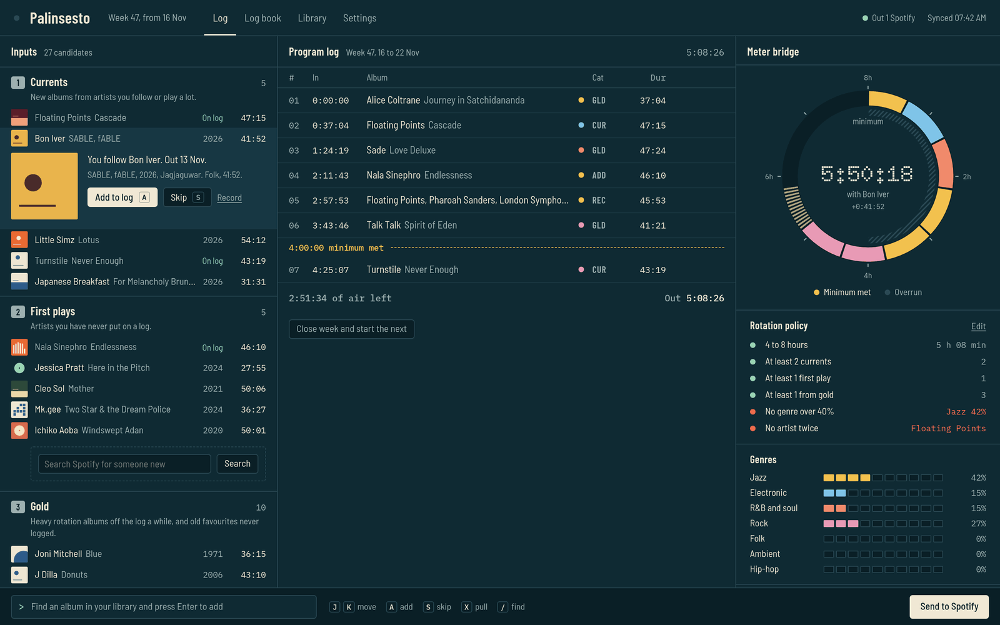
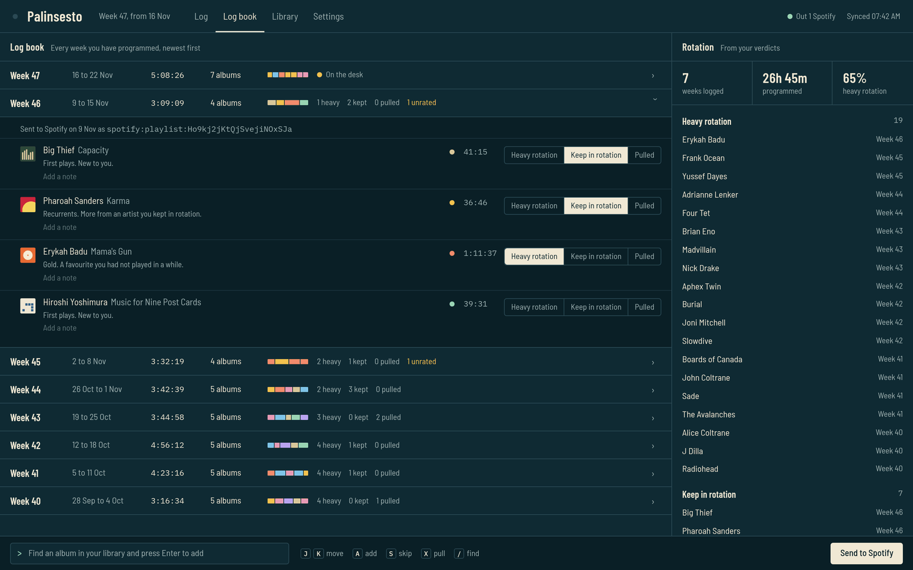
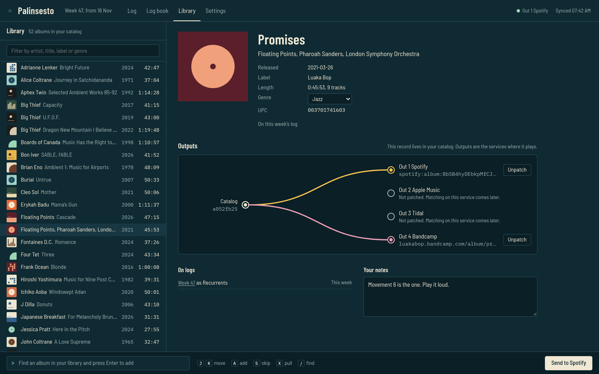
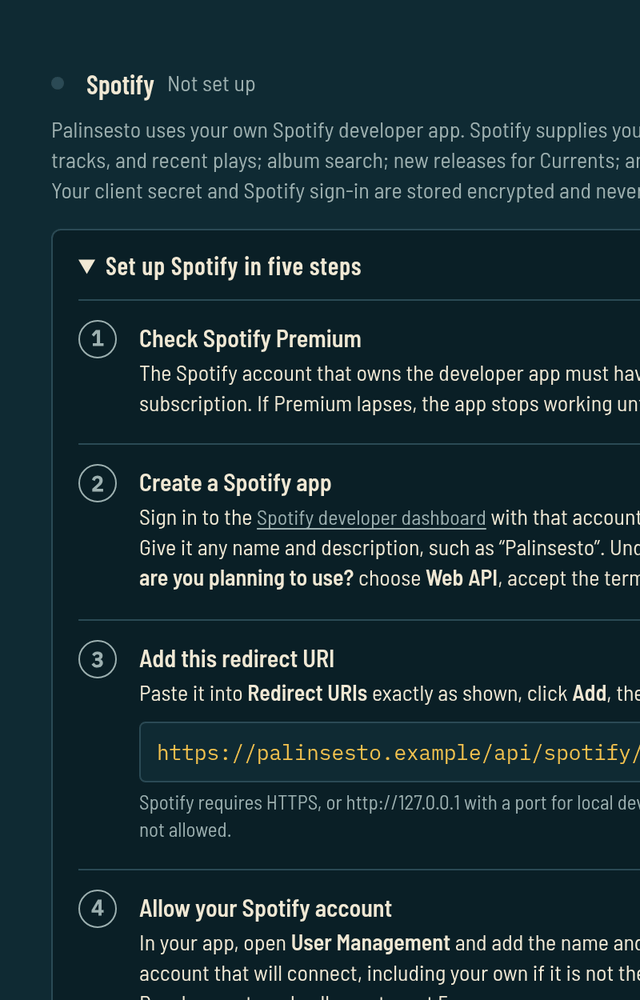

# Palinsesto

Palinsesto is a personal radio programmer's desk for building one album-length mix a week: 4 to 8 hours of whole albums that mix new releases, artists you've never heard, old favourites coming back, and more from artists you want to keep exploring. Each week goes into a log book with your verdicts, and those verdicts shape what's suggested next.

Albums and artists are Palinsesto's own records. Spotify supplies your listening signals, album search and the weekly playlist through your own Spotify developer app, and is only a link on those records, so your history doesn't depend on it.

> **Try it in two minutes.** Run `.agents/setup` and then `just storybook-fe`, and open http://localhost:6006. You'll see every screen on a synthetic demo desk, with no database, sign-in or Spotify account needed. When you want your own desk, follow [Run it locally](#run-it-locally).



## What it does

- **Inputs** suggests candidates in four lanes: **Currents** (new releases from artists you follow or play a lot), **First plays** (artists you've never logged), **Gold** (favourites off the log for a while) and **Recurrents** (more from artists you kept in rotation). Each candidate comes with a reason built from your own history.
- **Program log** holds the week's albums in air order with their in-times. The **program clock** and **meter bridge** check the week against your rotation policy: length, lane minimums, genre share, and no artist twice.
- **Send to Spotify** turns the week into a private playlist with every track of each album in order.
- **Log book** keeps every week. Give each album a verdict (Heavy rotation, Keep in rotation or Pulled) and it feeds next week's suggestions.
- **Library** is your own catalog. Each album record shows the services it's patched to.

| Log book | Album record |
| --- | --- |
|  |  |



**Spotify setup happens in the app.** Settings walks you through creating your own Spotify developer app, gives you the exact redirect URI to copy, and explains each error if something goes wrong. Your client secret and Spotify sign-in are stored encrypted and never shown again.

Screenshots come from Storybook and use synthetic data only.

<br clear="right">

## Run it locally

You need Linux or macOS, `curl`, and [uv](https://docs.astral.sh/uv/). Docker is optional: it's used for Postgres.

### 1. Install the toolchain

```sh
.agents/setup
```

This installs Node (from `.nvmrc`), pnpm, just, Python 3.12 and the locked backend and frontend dependencies. It doesn't start any services.

### 2. Look around in Storybook

```sh
just storybook-fe        # http://localhost:6006
```

Open `Screens/Desk` for each screen of the app and `Screens/Spotify setup` for each Spotify state and error. Storybook serves mocked API responses, so nothing else has to run.

### 3. Start Postgres and migrate

```sh
cp .env.example .env
docker compose up -d --wait postgres     # Postgres on 127.0.0.1:5433
uv run alembic upgrade head
```

Without Docker, install Postgres from your distribution, create a `palinsesto` database, and set `DATABASE_URL` in `.env` to point at it.

### 4. Sign in and connect a fake Spotify

You can run the whole app signed in without an Auth0 tenant or a Spotify account. A synthetic sign-in provider and a fake Spotify run next to the app on your machine. Use `127.0.0.1` throughout, because Spotify rejects `localhost`.

```sh
uv run uvicorn tests.oidc_fixture:app --port 55439          # synthetic sign-in, auto-approves
uv run uvicorn tests.fakes.spotify_server:app --port 55440   # fake Spotify
(cd src/palinsesto/web/frontend && pnpm build)
```

Then provision your User and Workspace once, and start the app with the variables listed in [Running signed in, without Auth0 or Spotify](docs/development.md#running-signed-in-without-auth0-or-spotify):

```sh
uv run python -m palinsesto.bootstrap --issuer http://127.0.0.1:55439 --subject synthetic-user
```

Open http://127.0.0.1:55438 and click **Sign in**. In **Settings**, enter the fake Spotify's client ID `0123456789abcdef0123456789abcdef` and secret `fedcba9876543210fedcba9876543210`, click **Save credentials** and then **Connect Spotify**. Settings then shows "Connected as Synthetic Listener".

Never expose the auto-approving sign-in fixture publicly.

### 5. Use real sign-in and Spotify

For your own desk, fill in `.env`:

- `OIDC_ISSUER`, `OIDC_CLIENT_ID`, `OIDC_CLIENT_SECRET`: an Auth0 (or other OIDC) regular web application with the callback `<BROWSER_ORIGIN>/api/auth/callback`.
- `OIDC_ALLOWED_EMAILS`: a JSON list of the emails allowed to sign in.
- `BROWSER_CSRF_SECRET`: a random string of at least 32 characters.
- `CONNECTION_SECRET_KEY`: a Fernet key, generated with the command in `.env.example`.

Provision your identity with `palinsesto.bootstrap`, using your provider's issuer and your user ID as the subject. Sign-in never creates a User. Then run `just dev` (backend on port 8000, frontend on 5173) and follow the Spotify guide in Settings.

## Develop

```sh
just gate                # format, lint, typecheck and unit tests (backend + frontend)
just test-integration    # needs PALINSESTO_TEST_DATABASE_URL pointing at a database named *test*
just dev                 # backend and frontend dev servers
```

- `src/palinsesto/`: the FastAPI backend. `src/palinsesto/web/frontend/`: the React frontend and its Storybook.
- [CONTEXT.md](CONTEXT.md): the domain language. [docs/plan.md](docs/plan.md): decisions and delivery order. [docs/architecture.md](docs/architecture.md): read before adding modules.
- [docs/development.md](docs/development.md): the full development guide, including tests, Storybook fixtures and migrations.
- `prototype/`: the original frontend-only prototype ("Rotation") and design studies, kept for reference.

## Status

A first working build: sign-in with Auth0, a single-owner Workspace, the catalog, weeks, log book and rotation policy on Postgres, and the Spotify connection with an in-app setup guide. It runs at https://palinsesto.mattjmcnaughton.com on an Amp Box, and only Matt can sign in; see [box-operations.md](docs/technical/box-operations.md).
